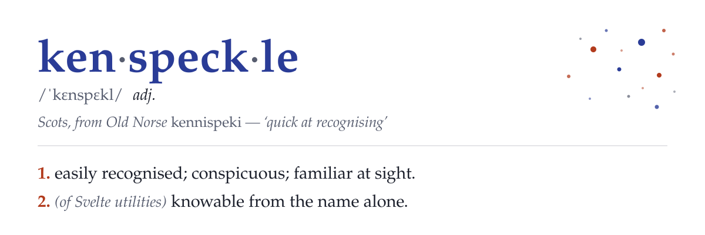

<picture>
	<source media="(prefers-color-scheme: dark)" srcset="docs/assets/banner-dark.svg">
	
</picture>

Svelte utilities you recognize at sight: each one is shaped the way Svelte shapes its own APIs, so it reads like something Svelte might have shipped.

## Shaped like Svelte

A utility makes the cut only if Svelte doesn't already handle it. Handled means a Svelte or Kit API covers it (a binding, `on()`, `onDestroy`, `<svelte:document>`, an `$effect` with a returned cleanup), the platform does (`field-sizing`, `:focus-within`), or a few lines of Svelte do, in which case it becomes a [recipe](https://kenspeckle.brandonpittman.workers.dev/docs/recipes) instead of an export.

What makes the cut takes the shape Svelte already uses for the same kind of thing. Ask these in order; the first yes decides:

1. **Is it global browser state?** A singleton with `current`, like `innerWidth` in `svelte/reactivity/window`: `documentVisible.current`. It reads the live value, and on the server it is `undefined`, as Svelte's are. Where a `<svelte:document>` or `<svelte:window>` binding already exists, the singleton earns its place only if modules need to read it outside a component: a polling store that pauses in a hidden tab does, and focus logic, which lives with its element, doesn't.
2. **Is it a value configured at construction?** A class with `current`, like `new MediaQuery(query)`: `new Idle(60_000)`, `new PersistedState('theme', 'light')`.
3. **Is it a value that follows another over time?** A class with `.of(fn)`, like `Spring.of(() => number)`, called in an effect root such as component init. It earns the class only if `current` holds something you couldn't produce where the value is written, the way a tween's in-between frames are. A debounced value and a previous value both fail this: each is a value already written, so `debounce()` or a saved copy at the write site covers it.
4. **Do you drive it with methods?** A class: `new FiniteStateMachine()`, `new StateHistory()`.
5. **Is it behavior on an element?** An attachment, named for what it does, as `copy` and `fade` are (`dragScroll`, `lockScroll`), or for the event it answers (`clickOutside`). An element value flows into your own `$state` through a callback, the way a function binding does (`bind:clientWidth={null, setWidth}`), never through a box the library owns, and it is named for that value, as a binding is (`scrollEdges`).
6. **Otherwise**, a plain function, with no `use` prefix, which is a React Hooks rule Svelte doesn't have.

Each shape names the Svelte API it mirrors. An export that can't name one isn't shaped yet.

## Attachments, one form

An element-bound utility returns an [attachment](https://svelte.dev/docs/svelte/@attach) and has no second form. An attachment is a function of the element, so outside a template you call it on one and get its cleanup back.

```svelte
<script>
	// outside a template
	const cleanup = clickOutside(() => close())(node);
</script>

<div {@attach clickOutside(() => close())}>…</div>
```

An attachment that observes the element hands what it sees to a callback, so the value lives in your state:

```svelte
<script>
	import { scrollEdges } from 'kenspeckle';

	let atBottom = $state(false);
</script>

<div {@attach scrollEdges((edges) => (atBottom = edges.blockEnd))}>…</div>
```

## Install

```sh
npm install kenspeckle
```

Peer dependencies: `svelte >= 5.40`, plus `@sveltejs/kit >= 2` for the `kenspeckle/kit` subpath (optional). SSR-safe — singletons read `undefined` on the server, as Svelte's window values do.

## What's shipped

Twelve exports, two entry points, each documented under [the docs site](https://kenspeckle.brandonpittman.workers.dev/docs). `kenspeckle` is Svelte-only; `kenspeckle/kit` adds the SvelteKit
pieces, so `$app/navigation` never enters the main entry.

| export                                                                                            | form                                   |
| ------------------------------------------------------------------------------------------------- | -------------------------------------- |
| [`FiniteStateMachine`](https://kenspeckle.brandonpittman.workers.dev/docs/finite-state-machine)   | class, with typed reactive `context`   |
| [`PersistedState`](https://kenspeckle.brandonpittman.workers.dev/docs/persisted-state)            | class, `.current`                      |
| [`Countdown`](https://kenspeckle.brandonpittman.workers.dev/docs/countdown)                       | class, `.current`                      |
| [`Idle`](https://kenspeckle.brandonpittman.workers.dev/docs/idle)                                 | class, `.current`                      |
| [`documentVisible`](https://kenspeckle.brandonpittman.workers.dev/docs/document-visible)          | singleton, `.current`                  |
| [`copy()` / `copyText()`](https://kenspeckle.brandonpittman.workers.dev/docs/copy)                | attachment                             |
| [`scrollEdges()`](https://kenspeckle.brandonpittman.workers.dev/docs/scroll-edges)                | attachment, edges to a callback        |
| [`viewTransition()`](https://kenspeckle.brandonpittman.workers.dev/docs/view-transition)          | function; navigation form under `/kit` |
| [`viewTransitionName()`](https://kenspeckle.brandonpittman.workers.dev/docs/view-transition-name) | attachment, `/kit`                     |
| [`retreat()`](https://kenspeckle.brandonpittman.workers.dev/docs/view-transition)                 | function, returns a disposer, `/kit`   |
| [`debounce()`](https://kenspeckle.brandonpittman.workers.dev/docs/debounce)                       | function wrapper                       |
| [`throttle()`](https://kenspeckle.brandonpittman.workers.dev/docs/throttle)                       | function wrapper                       |

`FiniteStateMachine` has a typed, `$state`-backed `context` object visible to lifecycle hooks and
guards — the sidecar-data mechanism every real FSM grows, built in.

View transitions are what the package is for so far; they get their own section below.

## Planned

The rest of the plan. These names are the design, not an API you can call — nothing below has
shipped.

| export                | form                                                                                              |
| --------------------- | ------------------------------------------------------------------------------------------------- |
| `StateHistory`        | class: `new StateHistory(get, set)`, `.undo()`, `.redo()`                                         |
| `AsyncPersistedState` | class over IndexedDB: `await` it, or read `.current`, `.loading`, `.error`, like a remote `query` |
| `CurrentPosition`     | class: `new CurrentPosition(options)`, `.current`                                                 |
| `pressedKeys`         | singleton, read like a set: `.has(key)`                                                           |
| `clickOutside()`      | attachment                                                                                        |
| `shortcut()`          | attachment                                                                                        |
| `lockScroll`          | attachment ≡ helper, stacked lock counting                                                        |
| `dragScroll()`        | attachment                                                                                        |

Dropped, deliberately, because Svelte, Kit or the platform already handles it:

- `Context`: Svelte ≥ 5.40's `createContext` returns a typed `[get, set]` pair.
- `Debounced` / `Throttled`: `debounce()` / `throttle()` writing into a `$state`, with any effect that follows a source kept in the component that owns it.
- `elementSize`, `elementRect`, `resized`: the dimension bindings (`bind:clientWidth`, `bind:contentRect`, `bind:borderBoxSize`) already measure with a `ResizeObserver`.
- `autosize`: CSS `field-sizing: content`, Baseline since June 2026.
- `intersected`, `inViewport`: an inline attachment that creates an `IntersectionObserver` and returns its `disconnect`.
- `mutated`: the same inline attachment around a `MutationObserver`.
- `focusWithin`: CSS `:focus-within` for styling, and `onfocusin` / `onfocusout` with `relatedTarget` for a value.
- `scrollState`, except its edges: `onscroll` gives an element's position, a comparison with the last value gives direction, and `<svelte:window bind:scrollY>` covers the window.
- `activeElement`: `<svelte:document bind:activeElement />`, since focus logic lives in the component that holds the element.
- `Previous`: save the old value where you write the new one (`previous = count; count = next`); for a prop you don't write, an `$effect.pre` does it.
- `mounted`: `onMount` setting a `$state`.
- `listen`: `on()` from `svelte/events`.
- `interval`, `animationFrames`: an `$effect` that starts the timer or loop and returns its cleanup.
- `onCleanup`: `onDestroy`, or an effect's returned cleanup.
- `watch` / `watchOnce`: an effect responds to state being a certain way, not to it changing; handle the change where it happens.
- `extract`: nothing here takes a value-or-getter.
- `boolAttr`: Svelte omits nullish attributes, so `data-x={flag || undefined}`.

The [recipes](https://kenspeckle.brandonpittman.workers.dev/docs/recipes) page spells out the replacements for `autosize`, `intersected`, `mutated`, `focusWithin` and `Previous`.

Waiting in the backlog: `resource`, since SvelteKit remote functions cover the server-data case, and `searchParams`, since Kit's `page.url.searchParams` and `goto` cover reads and writes until a typed layer earns its place.

## View transitions

Two entry points. `kenspeckle` exports the same-route form; `kenspeckle/kit` adds the SvelteKit
navigation form, so `$app/navigation` never enters the main entry. The `/kit` subpath expects
`@sveltejs/kit` — an optional peer.

### The contract

One attribute on `<html>`, absent when idle:

| `data-view-transition` | written by                                            |
| ---------------------- | ----------------------------------------------------- |
| `forward`              | a navigation                                          |
| `retreat`              | a navigation the predicate claims, or a Back popstate |
| `step-forward`         | `viewTransition(update)`                              |
| `step-retreat`         | `viewTransition(update, { retreat: true })`           |

Every animation is yours, keyed off that value. An unprefixed `::view-transition-old|new(name)` rule
matches both kinds, so scope it when a step and a navigation must differ.

```css
html[data-view-transition='forward']::view-transition-old(root) {
	animation: slide-out-left 300ms;
}
```

### Navigations

Register once, from the root layout:

```svelte
<script>
	import { viewTransition } from 'kenspeckle/kit';

	viewTransition();
</script>
```

Direction is a predicate, never a flag: Kit skips `beforeNavigate` for a navigation begun while
another is in flight, so a flag set at click time can be stranded and reverse a later navigation.
`retreat()` returns an identity-guarded disposer, shaped for `$effect` cleanup.

```svelte
<script>
	import { retreat } from 'kenspeckle/kit';

	$effect(() => retreat((navigation) => navigation.to?.route.id === '/'));
</script>
```

A Back popstate is a retreat without asking. A Forward popstate is not.

### Steps within a route

`onNavigate` never fires for a wizard advancing its own state, so drive the primitive directly:

```svelte
<script>
	import { viewTransition } from 'kenspeckle';

	let step = $state(0);
	const go = (delta) => viewTransition(() => (step += delta), { retreat: delta < 0 });
</script>
```

The update callback suspends rendering until it settles, which past half a second reads as a hang —
`deadline` (600ms) skips the transition rather than let it. With no `document.startViewTransition`,
or under `prefers-reduced-motion`, the update still runs, untransitioned, and no attribute is
written.

### Named elements

`viewTransitionName` claims `view-transition-name` for the duration of a transition and releases it
after. Two elements holding one name silently abort the whole transition, which is why claims are
scoped rather than left in static CSS.

```svelte
<button {@attach viewTransitionName('back-button')}>Back</button>
```

`when` claims only for navigations it accepts; `onArrival` claims inside the update callback instead,
for an element that mounts during the transition. Outside a template, call the attachment on the
element to get its disposer:

```js
const dispose = viewTransitionName('back-button')(element);
```

**Claims are navigation-only.** The registration form drives the capture and arrival phases;
`viewTransition(update)` on a same-route step names nothing. Morph a stepping element with static
`view-transition-name` in CSS instead.

## Claude Code plugin

This repo doubles as a Claude Code plugin with two agent-facing guides.
`skills/view-transitions/` covers the view-transition tier — the
`data-view-transition` contract, `viewTransitionName` claims and their phases,
the duplicate-name abort, and the list of things the library already handles so
an agent stops reimplementing them. `skills/finite-state-machine/` covers
`FiniteStateMachine` — the always-transitions rule, the `'*'` re-entry hazard,
lifecycle ordering and context. Point a marketplace entry at this repo
(`.claude-plugin/plugin.json` is at the root) and it installs as `kenspeckle`,
invoked as `/kenspeckle:view-transitions` and `/kenspeckle:finite-state-machine`.
It bundles no MCP server; for the Svelte MCP, install the official `svelte`
plugin from [`sveltejs/ai-tools`](https://github.com/sveltejs/ai-tools).

The skill and the code ship in the same change, same rule as the docs pages.
